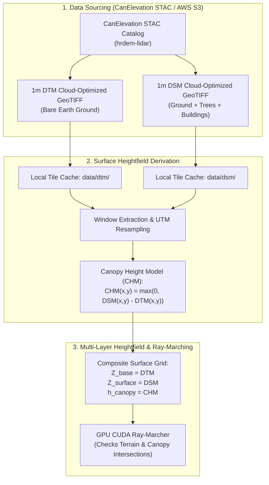
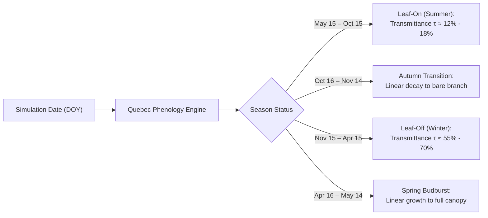
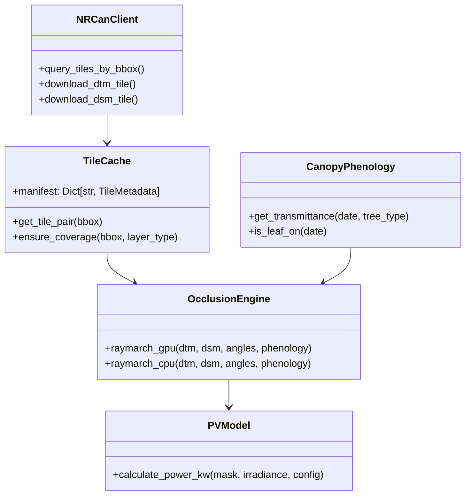
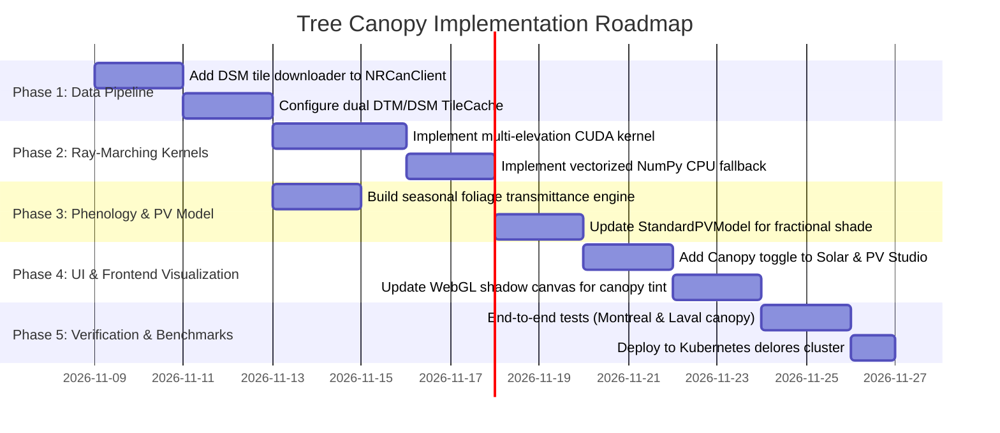

# LuxTerra: Tree Canopy Integration Plan for High-Precision Solar & Shadow Modeling

> [!IMPORTANT]
> LuxTerra currently performs GPU ray-marching over **Digital Terrain Models (DTM)**, capturing macroscopic hill and ridge topography. Integrating tree canopy expands the elevation field from bare earth to a full **Digital Surface Model (DSM)** and **Canopy Height Model (CHM)**, capturing urban street trees, residential forest edges, and park groves with 1-meter resolution.

---

## 1. Executive Summary & Objective

In Quebec's urban and peri-urban landscapes (such as Mount Royal, Sainte-Lucie, and Laval), trees are often the **dominant obstruction** to residential and commercial solar arrays:
- An 18-meter deciduous sugar maple or mature pine within 15 meters of a rooftop or ground-mount array can reduce annual solar irradiance by **25% to 65%**.
- Deciduous tree canopy exhibits distinct **seasonal phenology**: full dense foliage in summer (leaf-on, ~10–18% direct transmittance) vs. bare branch architecture in winter (leaf-off, ~50–70% direct transmittance).

This plan details the end-to-end architecture to ingest 1m LiDAR surface data, compute ray-canopy intersections on the GPU, model seasonal foliage transparency, and present clear visual toggles in the LuxTerra interface.

---

## 2. Elevation Data Architecture: DTM vs. DSM vs. CHM



### 2.1 Native NRCan CanElevation Co-Registration
CanElevation HRDEM distributes **paired, pixel-for-pixel co-registered 1m Cloud-Optimized GeoTIFFs**:
- `dtm`: Bare-earth elevation $z_{DTM}(x,y)$ (m above CGVD2013).
- `dsm`: First-return surface elevation $z_{DSM}(x,y)$ (m above CGVD2013).
- Both share the exact same spatial grid, bounds, UTM projection, and nodata conventions.

### 2.2 Mathematical Surface Definitions

$$\text{CHM}(x,y) = \max\left(0,\, z_{DSM}(x,y) - z_{DTM}(x,y)\right)$$

Where:
- $\text{CHM}(x,y) < 1.5\,\text{m}$: Bare ground, grass, low shrubs (treated as bare terrain).
- $\text{CHM}(x,y) \ge 1.5\,\text{m}$: Canopy or elevated structures.

---

## 3. Optical Physics: Seasonal Canopy Transmittance Model

Unlike solid granite ridges, tree canopy is a **turbid porous medium** with variable optical depth. Shading must distinguish between:
1. **Opaque Obstacles** (Terrain, building structures): Transmittance $\tau = 0.0$.
2. **Vegetative Canopy**: Transmittance $\tau_{\text{canopy}} \in (0.0, 1.0)$ governed by Beer-Lambert extinction and seasonal phenology.



### 3.1 Seasonal Foliage Schedule (Quebec Temperate/Boreal Zone)

| Phenological Stage | Calendar Window (Approx) | Dominant Tree State | Direct Beam Transmittance ($\tau_{\text{direct}}$) | Diffuse Attenuation ($\tau_{\text{diffuse}}$) |
| :--- | :--- | :--- | :--- | :--- |
| **Full Foliage (Leaf-On)** | May 15 – Oct 15 | Dense deciduous broadleaf & conifers | $0.12 - 0.18$ | $0.20 - 0.30$ |
| **Autumn Senescence** | Oct 16 – Nov 15 | Leaf drop / bare branch transition | $0.20 \to 0.60$ | $0.30 \to 0.65$ |
| **Bare Branch (Leaf-Off)**| Nov 16 – Apr 15 | Deciduous bare crowns; conifer needles | $0.55 - 0.65$ | $0.65 - 0.75$ |
| **Spring Bud-Burst** | Apr 16 – May 14 | Rapid leaf unfolding | $0.60 \to 0.18$ | $0.65 \to 0.25$ |

### 3.2 Transmittance Formulation

$$\tau(t) = \begin{cases}
\tau_{\text{summer}}, & \text{DOY} \in [135, 288] \\
\tau_{\text{winter}}, & \text{DOY} \in [320, 365] \cup [1, 105] \\
\text{smoothstep}(\text{DOY}), & \text{transition periods}
\end{cases}$$

For mixed stands in Quebec (e.g., Mount Royal with red oak, sugar maple, and white pine), the effective direct beam irradiance reaching a cell shaded by canopy is:

$$I_{\text{direct, shaded}} = \tau_{\text{canopy}} \times I_{\text{direct, unshaded}}$$

---

## 4. Ray-Marching Engine Enhancements (GPU & CPU)

### 4.1 Target Point Altitude Disambiguation

A key distinction between rooftop and ground-mount arrays is their elevation relative to local vegetation:

$$z_0 = \begin{cases}
z_{DSM}(x_0, y_0), & \text{if Deployment Mode } = \text{Rooftop (mounted on roof)} \\
z_{DTM}(x_0, y_0) + h_{\text{stand}}, & \text{if Deployment Mode } = \text{Ground-Mount (e.g. 1.5m rack)}
\end{cases}$$

> [!NOTE]
> On a rooftop, a solar panel is sitting on top of the building ($z_0 = z_{DSM}$), meaning it is **not** shaded by the building itself, but **is** shaded by taller adjacent trees or terrain if the sun angle dips behind them.
> On the ground, the panel sits at $z_{DTM} + 1.5\,\text{m}$, meaning any tree taller than 1.5m between the panel and the sun casts shade.

### 4.2 CUDA Ray-Marching Kernel (Multi-State Occlusion)

Instead of a binary 0 or 1, each pixel in the shadow mask can encode an 8-bit occlusion state:
- `255`: Completely unshaded (100% direct beam sunlight).
- `0`: Completely blocked by solid terrain or structural ridge (0% direct beam).
- `30 – 160`: Canopy shaded (attenuated by $\tau_{\text{canopy}} \times 255$).

```cpp
// Enhanced CUDA ray-marcher with terrain + canopy classification
extern "C" __global__
void raymarch_canopy_kernel(
    const float* __restrict__ dtm,          // Bare terrain (H, W)
    const float* __restrict__ dsm,          // Surface elevation (H, W)
    unsigned char* __restrict__ mask,       // Output mask (patch_H, patch_W)
    int H, int W,
    int patch_y_offset, int patch_x_offset,
    int patch_H, int patch_W,
    float step_dr, float step_dc,
    float tan_alpha,
    float step_dist,
    int max_steps,
    float canopy_transmittance,             // e.g. 0.15 (summer) or 0.60 (winter)
    bool is_rooftop
) {
    int px = blockDim.x * blockIdx.x + threadIdx.x;
    int py = blockDim.y * blockIdx.y + threadIdx.y;
    if (px >= patch_W || py >= patch_H) return;

    int r0 = patch_y_offset + py;
    int c0 = patch_x_offset + px;

    // Determine receiver altitude z0
    float z0 = is_rooftop ? dsm[r0 * W + c0] : (dtm[r0 * W + c0] + 1.5f);
    
    float min_transmittance = 1.0f;

    for (int s = 1; s <= max_steps; ++s) {
        float r_f = (float)r0 + (float)s * step_dr;
        float c_f = (float)c0 + (float)s * step_dc;

        if (r_f < 0.0f || r_f >= (float)(H - 1) || c_f < 0.0f || c_f >= (float)(W - 1)) {
            break;
        }

        // Bilinear interpolation for both DTM and DSM
        float z_dtm = sample_bilinear(dtm, r_f, c_f, H, W);
        float z_dsm = sample_bilinear(dsm, r_f, c_f, H, W);

        float z_ray = z0 + ((float)s * step_dist) * tan_alpha;

        if (z_dtm > z_ray) {
            // Blocked by solid earth: 100% opaque
            min_transmittance = 0.0f;
            break;
        } else if (z_dsm > z_ray) {
            // Blocked by canopy: attenuate by seasonal transmittance
            if (canopy_transmittance < min_transmittance) {
                min_transmittance = canopy_transmittance;
            }
        }
    }

    // Convert transmittance [0.0, 1.0] to 8-bit byte [0, 255]
    mask[py * patch_W + px] = (unsigned char)(min_transmittance * 255.0f);
}
```

---

## 5. System Architecture & Component Changes



### 5.1 Backend Pipeline Modifications
1. **`NRCanClient` ([`nrcan_client.py`](file:///home/alf/Code/dsh-sandbox/workspace/LuxTerra/backend/app/services/elevation/nrcan_client.py))**:
   - Update asset query to fetch both `dtm` and `dsm` COG URLs from CanElevation STAC.
2. **`TileCache` ([`tile_cache.py`](file:///home/alf/Code/dsh-sandbox/workspace/LuxTerra/backend/app/services/elevation/tile_cache.py))**:
   - Extend directory structure to support `data/dsm/` parallel to `data/dtm/`.
   - Update manifest to track pair status (`dtm_cached: true, dsm_cached: true`).
3. **`LocalGeoTIFFService` ([`local_geotiff.py`](file:///home/alf/Code/dsh-sandbox/workspace/LuxTerra/backend/app/services/elevation/local_geotiff.py))**:
   - Extract co-registered dual-raster windows: `(dtm_grid, dsm_grid)`.
4. **`PhenologyService` (New: `backend/app/services/solar/phenology.py`)**:
   - Computes daily Quebec deciduous/coniferous transmittance based on solar date.
5. **`SimulationRequest` Schema ([`domain.py`](file:///home/alf/Code/dsh-sandbox/workspace/LuxTerra/backend/app/schemas/domain.py))**:
   - Add parameters:
     - `include_tree_canopy: bool = True`
     - `canopy_mode: str = "seasonal"` (`"seasonal"`, `"leaf_on"`, `"leaf_off"`, `"opaque"`)

### 5.2 Frontend UI & Visualization Modifications
1. **Studio Configuration Toggle ([`PVConfigPanel.js`](file:///home/alf/Code/dsh-sandbox/workspace/LuxTerra/frontend/src/components/PVConfigPanel.js))**:
   - Add a "Tree Canopy Shading" toggle switch:
     - `🌲 Tree Canopy (DSM)`: Active / Disabled
     - Foliage selector: `Auto (Seasonal)` / `Dense Summer` / `Bare Winter`
2. **WebGL Shadow Shader ([`ShadowCanvasLayer.js`](file:///home/alf/Code/dsh-sandbox/workspace/LuxTerra/frontend/src/components/ShadowCanvasLayer.js))**:
   - Support rendering two shadow levels:
     - Solid terrain shade (deep dark navy/slate `rgba(15, 23, 42, 0.70)`)
     - Filtered canopy dappled shade (softer translucent green-tinted shadow `rgba(20, 50, 40, 0.45)`)

---

## 6. Implementation Roadmap



### Milestone Breakdown
- **Phase 1: Ingestion & Caching**: Fetch 1m DSM tiles from AWS S3 `canelevation-dem` bucket and cache alongside DTM.
- **Phase 2: GPU Ray-Marcher**: Update CUDA and NumPy ray-marchers to trace rays against both DTM and DSM with target elevation $z_0$ conditioned on rooftop vs. ground mount.
- **Phase 3: Phenology Model**: Incorporate day-of-year seasonal leaf-on/leaf-off attenuation.
- **Phase 4: UI Integration**: Add canopy mode controls in the right-hand collapsible Studio dock.
- **Phase 5: Verification & Deployment**: Validate against Mount Royal and Laval urban forest benchmarks, execute pytest/Vite suites, and deploy to Kubernetes.

---

## 7. Key Decisions & Open Questions

> [!TIP]
> Before beginning implementation, your input on the following decisions will guide the implementation:

1. **Default Shading Mode**:
   - *Option A (Recommended)*: Enable **Tree Canopy Shading (Seasonal Auto)** by default, with a toggle to view "Bare Terrain Only". This immediately gives real-world shading accuracy for both urban roofs and park edges.
   - *Option B*: Keep bare terrain as default, and let users opt-in to canopy modeling via a switch.

2. **Canopy Porosity Visualization**:
   - *Option A (Recommended)*: **Dappled / Semi-Transparent Canopy Shade** — Render solid terrain shadows in dark navy (`rgba(15, 23, 42, 0.75)`) and tree canopy shade in semi-transparent dappled tone (`rgba(22, 60, 45, 0.45)`), showing where light filters through branches.
   - *Option B*: **Binary Shade** — Treat any tree intersection as full shade for maximum computational simplicity and conservative PV yield estimates.

3. **Building Roof Identification**:
   - In HRDEM DSM, both tree crowns and building roofs exist.
   - For **Rooftop Mode**, does the array sit on the DSM roof surface ($z_0 = z_{DSM}$), with trees casting shadows onto the roof? (Recommended: Yes, this accurately models trees overhanging roofs).
