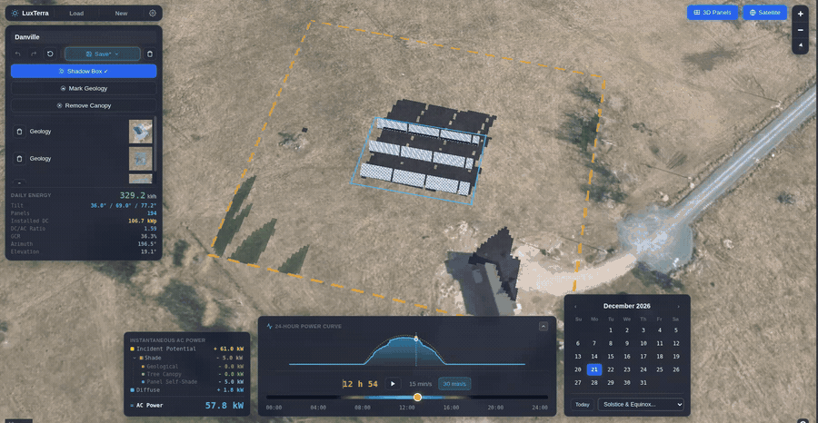

# LuxTerra

**LuxTerra** is a GPU-accelerated solar potential, terrain-shadow, and tree-canopy occlusion simulator for Quebec. It models how bare-earth topography, vegetative tree canopy, and inter-row panel self-shading affect solar output across custom plots of land (up to `100,000 m²`) at 1-meter spatial resolution throughout any day of the year.



## Key Features
- **Terrain & Tree Canopy Occlusion Engine:** GPU-accelerated ray-marching via CuPy targeting local NVIDIA GPUs (with a vectorized NumPy CPU fallback). Combines bare-earth **DTM** geological shadows with **DSM − DTM** tree canopy shadows using Beer-Lambert attenuation, quantized canopy shade levels (`0–7`), and seasonal foliage phenology (`Auto`, `Leaf-On`, `Leaf-Off`).
- **3D Solar Array & 72-Cell Half-Cut Physics:** Custom WebGL 3D panel layer (`SolarPanel3DLayer`) with terrain-following table tilts, 3D Sky View Factor (`SVF`) diffuse scaling, and **12 × 6 (72-cell) split/half-cut** bypass evaluation (`2 × 3` substrings per module). Hovering any individual panel displays its real-time `Incident Potential`, `Geological`, `Tree Canopy`, `Panel Self-Shade`, `Diffuse`, and `AC Power` breakdown in Watts.
- **Solar & PV Modeling:** Clear-sky radiation using `pvlib.clearsky.ineichen`, configurable **Rooftop (100% GCR)** vs. **Ground-Mount (45% GCR)** deployment modes, adjustable module efficiency and performance ratio, and interactive **Mark Geology** / **Remove Canopy** polygon overrides.
- **High-Resolution Elevation:** Powered by NRCan / Données Québec 1m LiDAR High Resolution Digital Terrain and Surface Models (DTM/DSM) indexed via `manifest.json`.
- **Interactive Desktop & Mobile UI:** MapLibre GL JS with OSM street and ESRI satellite layers, rectangle and free-draw polygon tools (clamped to `≤ 100,000 m²`), optional **Shadow Box** context envelope, saved shapes & camera views, 24-hour power curve & timeline scrubber (`15 min/s` and `30 min/s` playback), and responsive touch-friendly mobile controls.

## Monorepo Layout
- `backend/` — FastAPI REST API, solar geometry, PV layout/self-shading physics, and CuPy/NumPy ray-marching engines.
- `frontend/` — Vite single-page application with MapLibre GL JS, WebGL 3D panel rendering, offscreen shadow canvas projection, and interactive telemetry dashboard.
- `k8s/` — Example Kubernetes Deployment, Service, and Ingress manifest (`luxterra.example.yaml`).
- `scripts/` — CLI utilities (`fetch_test_dtm.py` for acquiring/indexing LiDAR GeoTIFFs and `deploy.example.sh` for building and deploying to Kubernetes).
- `data/` — Local raster storage and `manifest.json` indices for `dtm/` and `dsm/` GeoTIFF tiles.
- `docs/` — Documentation media assets (`demo.gif`).

## Quickstart

### 1. Acquire Test LiDAR Rasters
Fetch the 1m resolution LiDAR rasters for the benchmark test sites (Montréal — Mount Royal flank & Sainte-Lucie-des-Laurentides):
```bash
.venv/bin/python scripts/fetch_test_dtm.py --preset all
```

### 2. Start the FastAPI Backend
```bash
.venv/bin/uvicorn backend.app.main:app --host 127.0.0.1 --port 8000 --reload
```
- Health & GPU Check: `http://127.0.0.1:8000/api/health`
- Interactive OpenAPI Docs: `http://127.0.0.1:8000/docs`

### 3. Start the Vite Frontend
```bash
cd frontend
npm run dev
```
Open `http://127.0.0.1:5173` in your browser.

## Testing & Verification

### Backend Unit & Integration Tests
```bash
.venv/bin/pytest -v
```

### Frontend Unit & End-to-End Tests
```bash
cd frontend
npm test
```

## Container & Kubernetes Deployment
Copy the example deployment templates and customize them for your cluster, registry, host paths, and ingress domain:
```bash
cp k8s/luxterra.example.yaml k8s/luxterra.yaml
cp scripts/deploy.example.sh scripts/deploy.sh
chmod +x scripts/deploy.sh
./scripts/deploy.sh
```
Both `k8s/luxterra.yaml` and `scripts/deploy.sh` are gitignored so local cluster details stay out of version control.
